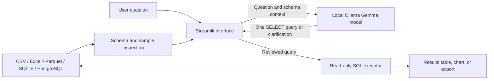

# QueryWise

**Ask your data. Understand the answer.**

QueryWise is a local analytics app that turns plain-language questions into SQL, lets the user inspect and edit the query, then shows the database result as a table or chart. For the bundled retail dataset, it uses a curated schema description; for uploaded and connected tables, it inspects the schema and sample rows.

## Project summary

- **Problem:** People who can describe a business question may not know SQL.
- **Approach:** A local Gemma 4 E2B model generates SQL using the selected table schema and sample rows. QueryWise executes the query locally and displays the result.
- **Data sources:** CSV and Excel uploads, large local CSV and Parquet files, SQLite databases, and PostgreSQL.
- **Stack:** Python, Streamlit, pandas, SQLite, PostgreSQL, Psycopg, Ollama, Gemma 4 E2B.
- **Model training:** No fine-tuning. The app uses schema context and prompt rules at query time.

Gemma 4 E2B was chosen because it runs locally with the laptop's available memory and does not need a hosted API key. The tradeoff is that a compact model can still make SQL mistakes or take time to answer, so QueryWise shows the SQL for review and the project evaluates results against trusted queries.

## Architecture

For the retail demo, pandas cleans the UCI workbook into Parquet and SQLite. `load_postgres.py` imports the prepared Parquet into PostgreSQL and creates a limited read-only account.

## Demonstrated capabilities

- Ask questions in plain English and inspect or edit generated SQL before execution.
- Analyze the 1,007,913-row prepared Online Retail II sales dataset.
- Upload CSV and Excel files, detect or choose header rows, or import large local CSV and Parquet files in batches.
- Connect to SQLite and PostgreSQL tables with schema and sample context.
- Run SQL in read-only mode with query time limits and result row limits.
- Review evaluation cases and error stages from CSV reports.

## Evaluation summary

On 2026-11-01, using Gemma 4 E2B and the prepared SQLite demo:

| Evaluation set | Result | Write-request guard | Approx. model time |
|---|---:|---|---:|
| SQLite development questions | 5/5 matched reference SQL | Passed | 122 seconds |
| PostgreSQL development questions | 5/5 matched reference SQL | Passed | 32 seconds |
| SQLite cross-backend validation questions | 5/5 matched reference SQL | Passed | See detailed CSV report |
| PostgreSQL cross-backend validation questions | 5/5 matched reference SQL | Passed | See detailed CSV report |

The cross-backend questions were used to diagnose and fix PostgreSQL filter errors. They are validation cases, not an untouched holdout. These are small, locally authored checks on one dataset, not a guarantee of accuracy for arbitrary questions or datasets.

## Data limitation

The prepared sales data excludes cancelled invoices and rows with non-positive prices. In this workbook, all negative-quantity rows fall into one of those excluded groups. The prepared demo therefore contains no returns, and its sales totals do not subtract returns. The original source workbook also has rows with missing customer IDs; customer-level rankings exclude those rows.

## Run locally

1. Install the requirements and Ollama model as documented in [README.md](README.md).
2. Double-click `run_querywise.bat` to start the app.
3. Choose a data source, enter the database password in the app when needed, and ask a question.

See [README.md](README.md) for setup, PostgreSQL import, evaluation commands, data cleaning rules, and UCI attribution.
